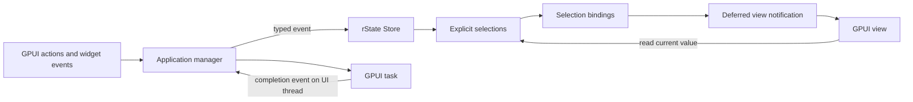

# rState GPUI adapter package design

Status: reusable integration in `desktop/rstate-gpui`, using `gpui-kit` pinned to `0.8.1` with its default `gpui-pre` 0.3.10 backend. The library includes snapshot selections, scoped view bindings, deferred notifications, dispatch error routing, command scopes and persistence feedback. Downstream dependency identities and linking are checked in a standalone consumer with its own lockfile. The existing document example remains a foundation fixture. The [adapter guide](desktop/rstate-gpui/README.md) records the concrete APIs and verification commands; optional tooling below remains a design proposal.

`rstate-gpui` connects rState's typed application state to GPUI views. rState owns domain data and synchronous transitions; GPUI owns rendering, widgets and presentation state. The adapter translates selected-state changes into deferred view notifications, manages observation lifetimes and provides a consistent place for desktop integration utilities.

The package is intended for document editors, planners, database clients and other applications where several views or windows share meaningful domain operations. Its value is easier coordination, reusable business logic and focused testing. Applications with predominantly local widget state may need only GPUI entities. Performance improvements must be measured in representative applications.

## Package scope and benefits

Most application-state capabilities already exist in rState. The adapter makes them convenient and safe to use from GPUI without duplicating their implementation.

| Capability | Existing rState foundation | Integration work |
| --- | --- | --- |
| Shared views and windows | Cloneable owning stores, weak handles and input-initialized factories | Document ownership conventions and independent bindings for each consuming view |
| Focused UI updates | Cached selections, explicit mapping and two-source combination | Equality-aware bindings and shared notification scheduling per view |
| Typed application operations | Events, pure transitions, synchronous dispatch, effects and emissions | Action handlers with explicit error reporting |
| Undo and Redo controls | Bounded snapshot history, reset and history status | Snapshot selectors for reactive toolbar and menu availability |
| Background operations | Typed result events and effects that can start external work | GPUI task ownership, cancellation and stale-result handling |
| Persistence feedback | Synchronous persistence, explicit save and separate persistence errors | Observable status covering failures, recovery and explicit operation outcomes |
| Transition debugging | Inspection callbacks with transition snapshots | An optional bounded inspector using application-provided event projections |
| Reusable application logic | A core independent of UI, JavaScript and async runtimes | A desktop example sharing domain behavior with headless tests and the WASM boundary |
| Reduced boilerplate | Scoped subscriptions and explicit comparators | Optional equality shortcuts and infallible observation helpers |

The existing behavior and native boundaries are documented in [README.md](README.md) and [API_STABILITY.md](API_STABILITY.md). This design preserves synchronous nested dispatch, shared notification ordering and immutable snapshot ownership. It adds no general atoms, automatic dependency tracking, actor integration or async runtime to the core.

## GPUI dependency selection

The adapter and consumers use exactly `gpui-kit = "=0.8.1"`, the same toolkit as `agent_git`. Its published manifest pins the default `gpui-pre` engine and matching platform packages to `0.3.10`. Applications import types through `gpui_kit`, start the native platform with `gpui_kit::application()`, and call `gpui_kit::init(cx)` before opening windows. See the [selected release](https://github.com/longbridge/gpui-kit/releases/tag/v0.8.1) and [published manifest](https://docs.rs/crate/gpui-kit/0.8.1/source/Cargo.toml).

The separate `desktop` workspace keeps toolkit dependencies out of the core and WASM workspace. The adapter has no direct libc dependency. A standalone consumer generates its own lockfile, verifies shared toolkit, engine and platform identities, and links against the adapter. This is the sole supported toolkit version.

Keep desktop platform dependencies in the adapter or example. Preserve the core's declared Rust baseline and WASM build path. If the selected engine requires a different toolchain or platform checks, choose a separate desktop workspace or explicitly separated verification targets rather than raising the core's requirements implicitly.

## State ownership

Application managers own document or application stores and dispatch domain events. Views own bindings to the state they display. Widgets retain focus, cursor position, IME composition, scroll position and private editing drafts. Commit a draft to domain state at the appropriate edit or submit boundary.

GPUI stores entity data in its `App`; `Context<T>` supplies entity-specific notification and observation operations. A renderable entity is a view. These mechanisms provide the presentation boundary for rState bindings. [GPUI contexts](https://github.com/zed-industries/zed/blob/e21ff1b368b074586e4dae0d9bbf15d5dd8a1476/crates/gpui/docs/contexts.md)



Bindings read current selected values through `Rc<T>`. They do not maintain a second mutable copy of domain context inside a GPUI entity. Separate domain stores remain appropriate for separate documents; a global store is an ownership choice, not an adapter requirement.

Selections may use `map` and `combine` before binding. Dependencies stay explicit. Combining inputs from independent stores does not create a transaction across those stores. The adapter preserves rState's same-root coherent derivation and exposes the latest available values when GPUI renders.

## Selection binding API

The foundation public surface centers on `SelectionBinding<T>` and one shared notification target per view. Construct `ViewBindings<V>::new(cx)` once per view, then use `bind(selection)`. Clone the `ViewBindings` handle when another constructor needs the same target.

The following sketch assumes construction inside a view's entity initializer. All selection operations shown are implemented in the core.

```rust
let bindings = ViewBindings::new(cx);

let title = bindings.bind(store.select(
    |context| context.title.clone(),
    |left, right| left == right,
));

let can_undo = bindings.bind(store.select_snapshot(
    |snapshot| snapshot.history_status().past > 0,
    |left, right| left == right,
));
```

The view retains the returned bindings and reads `title.get()` or `can_undo.get()` during rendering. `get()` returns the underlying selection's current shared value. It should not cache a subscription callback's payload as the authoritative displayed value.

Create bindings once when an entity is initialized or when its document dependency is deliberately replaced. Creating subscriptions during every render would accumulate work and obscure their lifetime.

Each binding owns its `Selection<T>`, a `ScopedSubscription`, an active registration identity and access to the view's shared notification target. Bindings are non-cloneable by default because their observation lifetime must be explicit. Independent consumers can bind cloned selection handles without imposing `T: Clone`.

Binding setup establishes an active registration, subscribes, stores the scoped guard and makes the current value immediately available through `get()`. rState subscriptions do not replay an initial value. The first render therefore reads the selection directly rather than waiting for a notification. Selectors and comparators retain their purity requirements.

## Deferred notification contract

An rState subscriber runs synchronously during `Store::send`. Directly updating a GPUI entity through a captured async context at that point can attempt to borrow the app or entity while a GPUI handler is still using it. The binding callback must only mark its registration dirty and schedule work.

The selected mechanism is a foreground job queued with `AsyncApp::spawn`. Spawning clones the async context and enqueues the future; entity updates borrow the app when performed. The job calls the weak entity's update operation and `cx.notify()` after the original handler returns. `AsyncApp::update` returns its callback result directly; app access after release can panic. Command scopes close automatically during orderly shutdown through a weak quit registration. Embeddings or tests releasing an app without shutdown must close or drop its scopes first. [Selected async context implementation](https://docs.rs/crate/gpui-pre/0.3.10/source/src/app/async_context.rs)

Immediately detach the returned notification `Task`. Dropping the task handle cancels its work, so an ignored return value could cancel the job as soon as the subscriber returns and leave the target marked pending indefinitely. Detached notification jobs remain short and use the weak view and active registration guards to decide whether notification is still needed. Longer command tasks retain their separate ownership and cancellation policy. [GPUI task lifetime](https://github.com/zed-industries/zed/blob/e21ff1b368b074586e4dae0d9bbf15d5dd8a1476/crates/scheduler/src/executor.rs#L405)

The adapter must implement these scheduling rules:

1. A changed selection marks its active binding registration dirty.
2. All bindings for one view share a pending-job flag and dirty-registration bookkeeping. At most one notification job is pending for that target.
3. Further changes add dirty work without queuing another pending job.
4. The job takes the current dirty work, ignores expired registrations and clears its pending state before notifying the view.
5. All internal borrows are released before touching GPUI or allowing captured user values to be destroyed.
6. A change occurring during notification schedules subsequent work normally; clearing an older job must not erase newer dirty work.

The initial design does not cancel detached notification jobs when bindings disappear. The job still clears pending bookkeeping before ignoring inactive registrations or a released view. If a future scheduling policy adds cancellation or recoverable rejection, it must also clear or replace the corresponding pending state so later changes can schedule normally.

Use registration identities or generations so a dropped binding's queued work cannot be mistaken for a replacement binding. A job originally queued by binding A must still deliver binding B's valid dirty work if A is dropped before execution. A pending flag stored independently in every binding would not provide coalescing across a view's different selections.

Nested dispatch can advance live state before an earlier callback finishes. Queue an invalidation, not a snapshot to render later. `SelectionBinding::get()` reads the current selection when the view actually renders.

Coalescing applies only to UI invalidation. Every domain event, effect, emitted message and inspection record retains its own delivery semantics. One notification does not imply one transition, one GPU draw call, one visual subtree redraw or an exact frame deadline.

## Lifetime and cleanup

The view is captured through `WeakEntity<V>`. Subscription callbacks capture only notification and registration metadata, not their observed selection or an owning store handle. The binding itself intentionally owns its selection, which keeps its source stores alive.

Dropping a binding first marks its registration inactive and invalidates its generation, then unsubscribes its scoped guard. Release guards and captured user values outside internal borrows. Cleanup relies on registration invalidation rather than canceling the detached job. Pending jobs check current registration activity before notifying. Once all relevant registrations are inactive, a pending job clears its bookkeeping without notifying the view.

A released view is ordinary cleanup. The binding subscriber returns `Ok(())`; an expired weak target must not become an rState subscriber failure, because that could skip inspection, persistence and effects after state has committed. Panics remain programming faults.

One document can be displayed by several windows. Each window has its own view targets and guards. Closing a window cancels its observation without canceling the document's other observers. A document manager may retain the store until the document closes; independent documents can come from one `StoreFactory` with separate input values.

## Dispatch and application errors

Action helpers should be thin conveniences around existing typed dispatch and native controls. They must expose or route `StoreResult<()>` explicitly. Preserve synchronous `send`, including synchronous callback-driven nested sends; do not introduce a mailbox around all domain events.

The current `StoreError::dispatch_status()` contract distinguishes `NotCommitted` from `Committed` for the reporting operation. A committed delivery error does not roll back state. A not-committed outer operation can still contain callbacks that committed nested changes. Neither status proves the current snapshot belongs to that operation or that retrying is safe. Helpers must not automatically replay or roll back an event based on status. [Dispatch error contract](API_STABILITY.md#dispatch-errors-report-the-owning-call)

Pure `transition` and `can` queries do not return dispatch status. `can` maps validation errors to `false` and propagates other failures. Views can display existing structured validation issues, but the adapter does not generate forms or infer application rules from schema metadata.

Automatic persistence failures use their separate reporting path. A successful domain dispatch does not by itself prove storage succeeded. UI notification failures, dispatch failures and storage failures need distinct application handling.

## Core additions

### Snapshot selections

`Store::select_snapshot(selector, comparator) -> Selection<T>` is implemented, with the selector receiving `&Snapshot<C>`. It reuses the caching, comparator-controlled identity, lazy reads, subscriptions and explicit composition contracts of context selections.

This supports metadata that can change independently of a projected context value. For example, a history-enabled no-op event can change Undo availability while a title selection remains equal. The snapshot selector must observe that metadata change without weakening equality suppression for existing context selections.

Undo and Redo bindings report structural history availability. Restoring a historical context may still fail current validation, so action handlers must retain the control operation's error path. Existing history is snapshot-based and does not replay effects or reverse arbitrary interior mutation.

Snapshot selections belong in rState because they are useful across UI frameworks. They add no GPUI dependency and require no `Clone`, serialization, `Send` or `Sync` bounds on context, events or selected values.

### Optional observation conveniences

Consider `select_eq(selector)` for selected values implementing `PartialEq`, and an infallible `watch(callback)` that returns a `ScopedSubscription`. These are ergonomic wrappers around existing selection and observation behavior. They must not change ordinary subscription drop semantics or the fallible subscription API.

Implement these only where the example demonstrates repeated boilerplate. Equivalent mapping and combination shortcuts can follow the same evidence rather than becoming an initial API checklist.

### Observable persistence status

Persistence bookkeeping currently lives outside snapshots. `persistence_error()` exposes the last failure, and successful operations can clear it without publishing a new domain snapshot. `select_snapshot` therefore does not solve persistence feedback by itself.

`Store::persistence_status()` returns the latest optional shared `PersistenceStatus`. `subscribe_persistence` registers an infallible callback without replay and returns the ordinary subscription type, including opt-in scoped cleanup. The opaque status exposes a monotonic sequence, the last activity, its typed outcome and the storage error as of that recorded observation. It reports failure, replacement, recovery and explicit save or clear outcomes. `ViewBindings::bind_persistence` observes this interface through the same deferred notification target as selection bindings.

Status is the latest observation rather than an operation log. Nested activity can coalesce, so sequences may jump. Direct reads reflect recorded activity immediately; feedback callbacks run after the outermost persistence operation releases its busy and I/O guards. They can retry or dispatch synchronously. A private infallible notification registry preserves cleanup and nested-delivery rules without draining the core's separate fallible domain-notification queue.

Explicit operation outcomes describe the final returned result, including queued failures and superseded saves. The storage error is separate from the latest activity outcome. `persistence_error()` remains the live error read; during an in-flight explicit operation, its legacy error callback can see an updated live error while status still describes a prior recorded outcome. Clearing storage can clear an error without saving current context. A successful write may be superseded by nested changes, and a prior delivery error may have skipped autosave. An absent error is not sufficient evidence for a `Saved` or `Clean` label. Revision-based saved/dirty claims require a separate precise contract and tests.

Status observation must preserve snapshot identity and existing persistence ordering. It must report reentrant changes coherently without making feedback callbacks another storage-error source. This work adds no async storage, migration, throttling or partial-context persistence to the core.

## GPUI task and command bridge

The desktop operations stage adds reusable task handling through an application-owned `CommandScope`. Its channels identify independent operation lanes with `Concurrent`, `Serial` or `Latest` policies. Applications choose whether a scope belongs to an application manager, another capability owner or a view. The core remains synchronous: an event commits state, an effect or emitted command submits work, and a typed completion event publishes its result later.

```text
LoadRequested → Loading state → GPUI task
GPUI task → LoadSucceeded or LoadFailed → synchronous Store::send
```

GPUI provides foreground and background executors. Owned request and result data crossing threads need the executor's `Send` requirements; stores, selections and `Rc` snapshots stay on the UI thread. [Selected GPUI executors](https://docs.rs/crate/gpui-pre/0.3.10/source/src/executor.rs)

An effect submits work and returns `Ok(())`. Submissions from synchronous store callbacks enter a FIFO command queue; a foreground job enters GPUI and starts the work after the callback stack unwinds. Command submission order is preserved, while concurrently running tasks may complete out of order. The application runner owns task handles, awaits completion through GPUI and routes outcomes back to the appropriate manager. Never block the UI thread with `block_on` or move a whole store into background work. Avoid retaining an owning `EffectScope` merely to dispatch a later result; weak store access or the document manager gives the lifetime an explicit policy.

Task lifetime must match the operation. Shared capability work belongs to its manager, so closing one consuming view does not cancel it. A view-specific search preview may end with that view. Closing the owning scope cancels its handles and disables late delivery. Submission channels and tickets hold weak scope references; they do not extend the owner's lifetime.

Cancellation alone is insufficient because completed or uncancelable work can still return. Channel identity identifies the operation lane, and monotonic request identities belong to the scope outside undoable snapshot history. Applications explicitly invalidate a channel or scope when input changes, state resets or their lifetime policy requires it. Replacement and invalidation reject stale delivery; Undo cannot revive an old request identity.

Serial channels preserve ordering by allowing already-started canceled work to finish before starting the next request; cancellation immediately suppresses its delivery. Pending requests can be removed immediately. Scope closure drops owned task handles. Cancellation does not promise rollback or interruption of operating-system work already running, and ordering applies within the chosen scope and channel.

Preserve every command that requires processing. Redraw coalescing must never silently discard emitted commands. Expected operation failures become typed domain outcomes; errors while dispatching those outcomes follow the dispatch error contract. A closed target is handled according to the task's documented cancellation policy.

This task bridge is narrower than general managed async effects or async atoms. The pinned XState Store reference also separates synchronous transitions from effects that initiate async work; its broader async atom API is a separate capability. [Pinned reference package](https://github.com/statelyai/xstate/tree/9b3a88fa43f4be5433797acfba18f27c40494bd2/packages/xstate-store)

## Optional transition inspector

An inspector can display initial state, received domain events, native controls and resulting state through existing inspection callbacks. It must consume the native inspection contract, including cleanup on an initial callback failure, and support future variants through fallback handling.

Transition events are borrowed during callbacks and need not implement `Clone` or `Debug`. Retained inspector records therefore require an explicit application formatter or owned projection. Snapshot retention is an opt-in choice that can retain substantial context and history. Bound the record count or memory budget, provide cleanup and avoid owning captures that form store cycles.

The inspector observes events in their delivered order. Synchronous nested operations can produce nested records before an outer record. It must not reinterpret callback order as event replay support or silently build a second undo system. Report recoverable projection or inspector UI failures through a separate diagnostics path rather than returning an inspection error that suppresses the dispatch's later effects.

## Package organization

Keep domain responsibilities focused and compose them through small entrypoints. An illustrative future package layout is:

```text
rstate-gpui/
  src/lib.rs
  src/binding.rs
  src/binding/registration.rs
  src/notification.rs
  src/notification/target.rs
  src/dispatch.rs
  tests/main.rs
  tests/binding/
  tests/notification/
  tests/dispatch/
  examples/documents/
  README.md
```

Add task, persistence-feedback and inspection domains when their implementation stage begins. Tests stay outside implementation directories in a mirrored tree. Usage explanations and rationale belong in Markdown; follow the repository's no-handwritten-code-comments convention.

The dependency direction is application → adapter → rState and selected GPUI. The rState core never depends on the adapter. Native/WASM reuse means sharing domain logic through the appropriate platform boundary; it does not require the GPUI adapter itself to compile for the browser.

Keep `Clone`, `Debug`, serialization and thread-safety bounds local to operations that need them. Sharing a binding target or cloning a handle must not accidentally require its selected value or context to implement those traits. Use private representations and the repository's API stability conventions for diagnostics and output records.

## Implementation stages

| Stage | Deliverables | Completion condition |
| --- | --- | --- |
| Foundation | Select and lock the GPUI engine; add snapshot selections, bindings, per-view scheduling and dispatch error routing | The basic document app runs with deterministic lifetime and reentrancy tests |
| Desktop operations | Task bridge, persistence status observation and corresponding bindings | Background work, cancellation, stale results and save failure recovery have explicit tested behavior |
| Optional tooling | Transition inspector and demonstrated ergonomic helpers | Each addition has a concrete example and bounded ownership behavior |

Reusable library features are verified through focused generic fixtures: an independent consumer workspace, deterministic GPUI command and binding tests, core persistence tests and native-policy WASM tests. The existing document example remains a foundation regression fixture. Application-specific managers, file workflows and UI expansion are outside this implementation scope.

Continue exercising the actual rState core through the existing WASM adapter where core contracts change. The GPUI layer requires its own native integration evidence; the JavaScript reference is not an oracle for desktop rendering.

## Acceptance tests and verification

| Area | Required observable behavior |
| --- | --- |
| Initial reads | A newly created binding has a current value without an initial replay notification. |
| Equality | Comparator-equal changes preserve selected handles and do not enqueue binding notifications. |
| Shared target | Several changed bindings on one view share a pending notification; different views remain independent. |
| Notification task lifetime | A queued detached job survives subscriber return, runs and clears pending state; a later change schedules and delivers another notification. |
| Reentrancy | Dispatch inside a GPUI handler and nested sends across stores complete without app/entity borrow failures or altered synchronous ordering. |
| Latest state | Coalesced rendering reads the final current selection rather than an earlier callback payload. |
| Cleanup | Dropping or replacing a binding invalidates its queued work; another live binding's dirty work still delivers. |
| Window ownership | Closing one window leaves other windows and document tasks usable; closing the final owning document releases its resources. |
| Trait bounds | Non-`Clone`, non-`Send` contexts and selected values remain usable on the UI thread. |
| Errors | Committed dispatch errors retain state; nested outcomes follow the reporting-call contract; released views do not cause subscriber errors or skip effects. |
| History | History-only changes update availability bindings; validation rejection during restore remains visible. |
| Tasks | Replacement, changed input, reset and closure reject obsolete completions; closing one shared view preserves document-scoped work. |
| Commands | Redraw coalescing preserves required command occurrences and core emission ordering. |
| Persistence | Failure, recovery and explicit clear outcomes update feedback without falsely claiming the current context is saved. |
| Inspector | Borrowed events are projected explicitly, record retention is bounded and dropping the inspector releases its registration. |

Use deterministic GPUI scheduling tests for notification counts, ordering and cleanup, plus a native desktop smoke test for actual windows, actions and rendering. Measure selector executions and adapter notifications separately from frame time. Shared immutable fields can avoid expensive context copies, but rState does not automatically provide structural sharing for application data.

For Rust implementation changes, run the applicable native tests, rustfmt and strict Clippy checks from [PLAYBOOK.md](PLAYBOOK.md#verification). Core changes also retain WASM linting, the core minimum-version check and relevant real Rust/WASM versus pinned-reference behavior tests. Browser-facing changes require type checking, production build and browser parity tests. Keep desktop platform checks separate where the selected engine requires it.

Before the first package release, resolve the engine/platform pin, supported desktop targets, adapter toolchain floor, concrete public API names and the task/status contracts introduced in the relevant stage. A release should demonstrate a working integration example and its acceptance tests rather than only the proposed API shape.
